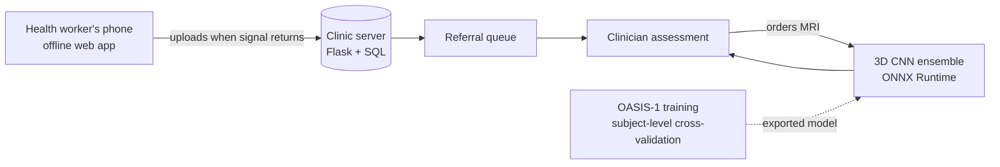

# Field-to-clinic dementia screening pipeline

**Live browser-only demo:** <https://sudev-04.github.io/Dementia-mri-screening/> (no sign-in; nothing you enter leaves your device).

A two-stage research prototype for finding people who may have dementia in places where a
neurologist and an MRI scanner are a long way off.

1. **In the field** a community health worker runs a ten-minute screening on a phone. It works
   with no signal, scores published instruments with published cut-offs, and produces a referral slip.
2. **At the clinic** the referral appears in a queue. If a clinician orders an MRI, a 3D
   convolutional network gives a second-opinion score with its uncertainty and a region map.



> **This is not a medical device.** Nothing here has been validated for clinical use. The
> screening rules are a draft awaiting clinical sign-off, and the MRI model is a research
> model trained on one small public cohort. Do not use it to make decisions about real people.

## What is and is not machine learning here

| Stage | Method | Why |
|---|---|---|
| Field screening | Published questionnaires scored by transparent rules (no ML) | There is no labelled field data to train on. A learned "risk %" would be invented. Published cut-offs can be read, cited and changed by a clinician. |
| MRI analysis | 3D CNN, 5-model cross-validation ensemble | Labelled public data exists (OASIS-1). |

The screening battery uses the **brief Community Screening Instrument for Dementia** (7 questions for
the person, 6 for a family member), derived from 15,022 people in India, China and Latin America
specifically for non-specialists and low-literacy settings; the **Short IQCODE** as an optional
longer family interview; and the **PHQ-2** mood check, because depression can look like memory loss.
It deliberately leaves out clock drawing and reading tasks, which are not feasible for people with
under five years of schooling. Sources and licence notes are in [docs/REFERENCES.md](docs/REFERENCES.md).

## Quick start (Windows, VS Code)

Open this folder in VS Code. To get one-click tasks and debug targets, copy the files in
`vscode-setup/` into `.vscode/` (see `vscode-setup/README.md`), then **Terminal > Run Task** and
run tasks 1, 2 and 3 in order. Or in PowerShell:

```powershell
py -3 -m venv .venv
.venv\Scripts\python -m pip install -r requirements-dev.txt
.venv\Scripts\python run_app.py seed-demo      # two local test accounts
.venv\Scripts\python run_app.py --demo-model   # http://localhost:5000
```

Double-clicking `run_app.bat` does the same thing.

| Test account | Password | Sees |
|---|---|---|
| `field1` | `field-demo-1` | Screening only |
| `clinic1` | `clinic-demo-1` | Screening, referral queue, MRI analysis |

`--demo-model` loads a model trained on synthetic noise so the MRI page can be tried. Every
output from it is labelled as meaningless. To make a scan file the demo will accept:
`python -m ml.synthetic --out data/synthetic --subjects 4` (needs `requirements-ml.txt`).

Run the tests with `python -m pytest -q` (47 tests; the three training tests need
`requirements-ml.txt` and are skipped without it).

Two things to know while developing:

- The app is cached for offline use, so the browser keeps serving old JavaScript and CSS after
  you edit them. In Chrome DevTools open **Application > Service Workers** and tick
  **Update on reload**, or bump `VERSION` in `app/static/sw.js`.
- To try it on a real phone the server must be reachable over **HTTPS** (offline mode is
  disabled by browsers on plain HTTP). An HTTPS tunnel to port 5000 is the quickest way.

## Training the MRI model on real data

1. **Request access to OASIS-1** at <https://sites.wustl.edu/oasisbrains/home/access/>. It is free,
   for non-commercial research, and you must agree to the data use terms yourself.
2. Open `notebooks/train_oasis_colab.ipynb` in Colab or Kaggle with a GPU and follow it. It
   downloads the 12 discs (about 1.5 GB each), keeps only the atlas-registered images, trains,
   and writes `model_export.zip`.
3. Unzip into `models/current/` and start the app without `--demo-model`.

Locally the same steps are:

```bash
python -m ml.train  --data-root data/oasis1 --csv data/oasis1/oasis_cross-sectional.xlsx --out runs/oasis_v1
python -m ml.train  --data-root data/oasis1 --csv data/oasis1/oasis_cross-sectional.xlsx --out runs/sanity --shuffle-labels
python -m ml.report runs/oasis_v1 > docs/RESULTS.md
python -m ml.export --run runs/oasis_v1 --dest models/current
```

### How the evaluation avoids the usual traps

More than half of the published CNN studies of Alzheimer's MRI reviewed by Wen et al. (2020)
may have reported inflated results because of data leakage, and splitting by slice instead of by
person inflated accuracy by 30 percentage points on OASIS in Yagis et al. (2021). The popular
four-class Kaggle image set has this problem built in. This pipeline:

- uses **one scan per person**; the 20 OASIS repeat sessions are dropped, and a test asserts no person crosses a split;
- keeps only **people aged 60+ with a clinical rating**, so the model cannot win by detecting age;
- does early stopping, calibration and threshold choice on a **validation split inside each training fold**;
- reports **out-of-fold** AUC with bootstrap intervals, plus calibration;
- compares against **logistic regression on age, sex, education and whole-brain volume**, in the same folds, with a paired interval on the difference;
- ships a **shuffled-label run** that must come out near AUC 0.5;
- refuses to export a shuffled-label run, and refuses at inference any scan that is not in the training geometry.

### What results to expect

No real-data results are included: the model has not been trained on OASIS yet, and this README
will not show numbers nobody measured. For orientation, Wen et al. found 3D CNNs reached a
balanced accuracy of 0.82 to 0.85 for Alzheimer's versus controls on ADNI, a linear SVM reached
0.88, and all of them fell to 0.61 to 0.73 when applied to OASIS. With about 200 usable people,
expect wide confidence intervals, and expect the brain-volume baseline to be hard to beat.
If you see accuracy above 0.95, look for a leak before celebrating.

## Layout

```
instruments/   questionnaires, referral rules with sources, shared test vectors
common/        scoring.py (referral logic) and preprocess.py (used by training AND serving)
app/           Flask API, database models, ONNX inference, offline web app in app/static
ml/            cohort building, model, training, baselines, export, synthetic data, report
notebooks/     Colab / Kaggle training notebook
tests/         pytest suite, JS/Python scoring parity check, Playwright browser test
docs/          model card, field protocol, references
vscode-setup/  VS Code tasks, debug configs and settings to copy into .vscode/
```

Design points worth knowing:

- **One rule set, two runtimes.** The phone scores offline in JavaScript; the server scores again
  in Python and its answer wins. 3,168 shared test vectors keep the two identical, and a mismatch
  is flagged to the worker and the clinic.
- **No training/serving skew.** `common/preprocess.py` is imported by both sides, and the server
  refuses a model exported with a different preprocessing version.
- **Uncertainty is shown, not hidden.** The clinic page shows each ensemble member's score and
  says plainly when they disagree about which side of the threshold a scan falls.
- **Privacy defaults.** No consent, no record. Personal data is never cached by the service
  worker, and uploaded screenings are deleted from the phone after 7 days.

## Browser-only demo site

`python tools/build_site.py site` builds a static copy that needs no server: screening is scored
by the same JavaScript the offline app uses, and **Check a scan** measures brain tissue fraction
locally with `app/static/js/scanlocal.js` (kept equal to the Python measurement by
`tests/js/scan_parity.mjs`). It has no sign-in, referral queue or neural network. The published
copy lives on the `gh-pages` branch.

## Known limits

- The field rules are a **draft**. Thresholds marked "project default" in `instruments/rules.json`
  are this project's choices, not published values.
- English only. Translating cognitive test items without validation would make scores meaningless,
  so no machine translations are shipped.
- The MRI model accepts only scans prepared like OASIS-1 (skull-stripped, T88 atlas, 1 mm). A scan
  straight from a hospital scanner is refused. A registration and skull-stripping step is the
  largest missing piece for real clinical input.
- One site, one 1.5T scanner, a mostly US research cohort. Performance elsewhere is unknown.
- Offline mode needs HTTPS (browsers only allow service workers on HTTPS or localhost). The
  `Dockerfile` has not been built or run by the author of this README.
- Data on the phone is not encrypted beyond what the device itself provides.

## Data and licence

Code: MIT. OASIS data is not included and may not be redistributed; cite Marcus et al. (2007)
and include the OASIS acknowledgement in anything you publish. Each instrument carries its own
terms (see `docs/REFERENCES.md`).
